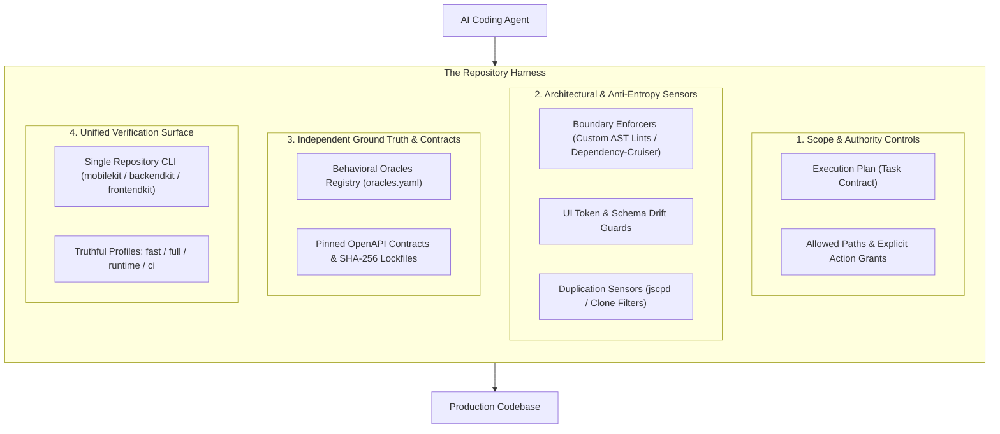
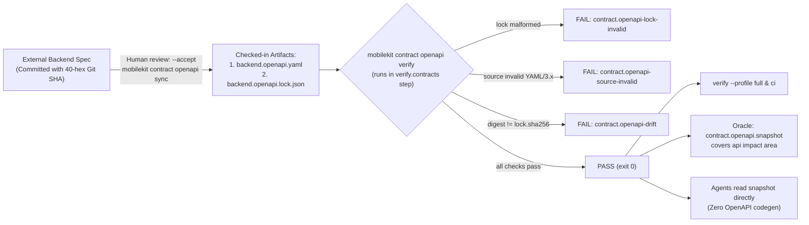
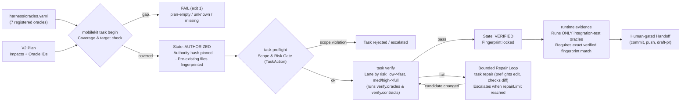
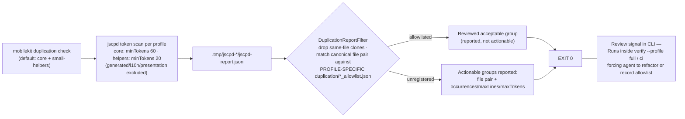
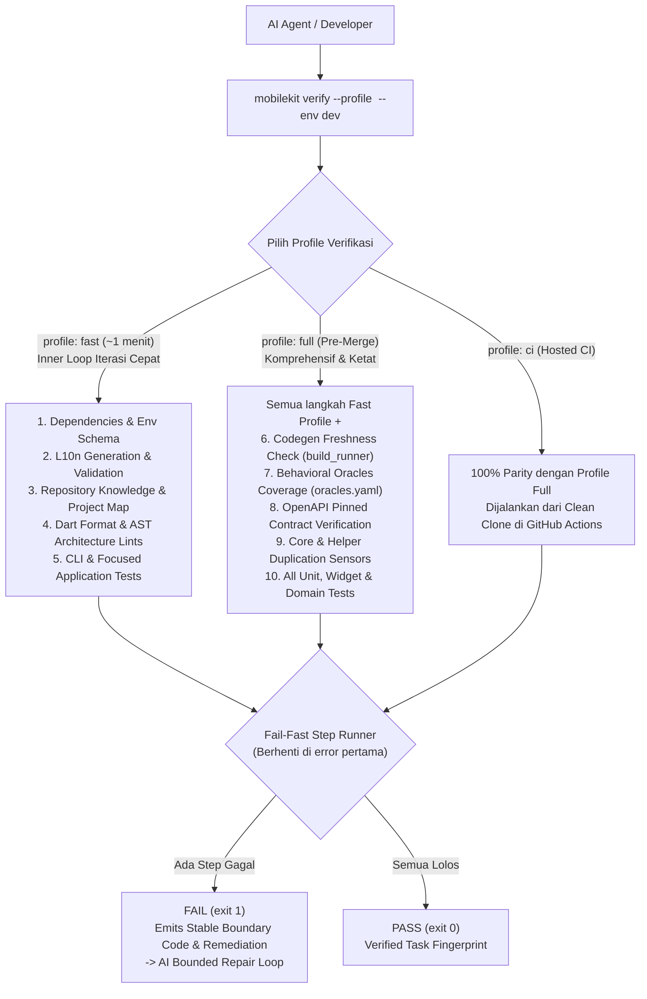
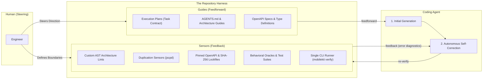

# Harness Engineering: Designing Codebases for the Agent-First Era

Dulu waktu awal-awal pakai AI coding, fokus utamaku hampir sepenuhnya cuma ke generation speed. Rasanya ajaib melihat model bisa bikin feature slice lengkap atau nulis boilerplate dalam hitungan menit. Tapi begitu codebase semakin besar, kecepatan itu justru mulai jadi bumerang. Waktuku malah habis buat benerin architectural leak, ngurai dependency antar modul yang bocor, dan ngebersihin duplikasi-duplikasi kecil yang lolos dari unit test.

Awalnya aku berpikir ini karena agents ngga punya suatu pedoman mutlak gimana cara nulis kode sesuai style dan architecture yang codebase itu miliki. Dari situ aku mulai membuat guide dari high level sampai ke implementasi paling bawah, eg: `project-architecture.md`, `data-domain-guide.md`, `presentation-architecture.md`, `testing-strategy.md`, `validation-cookbook.md` dan lain sebagainya. Aku juga mulai menulis instruksi detail di `AGENTS.md`, nambahin larangan-larangan eksplisit, dan berbagai penjelasan panjang lebar tentang aturan-aturan yang ada di codebase.

Cara ini memang sempat berhasil, tapi langsung berantakan begitu context window mulai penuh atau task-nya makin kompleks. Dan dengan pendekatan ini, akan sangat susah jika kita ingin nge-scale dalam sisi kecepatan atau banyaknya task yang ingin di implement dalam satu waktu. Di sisi lain, dengan meningkatnya beban dan kerumitan, model akan sering memilih jalan pintas (*path of least resistance*) untuk menyelesaikan task-nya. Bagi AI, tujuannya cuma satu: membuat kode berjalan dan test-nya hijau secepat mungkin. AI tidak peduli apakah solusinya merusak architecture atau tidak, selama tidak ada compiler atau linter yang melarangnya, jalan pintas adalah jalan terbaik di mata model.

Sebenarnya issue ini cukup ramai jadi bahan diskusi di X, di late 2025 - early 2026 saat claude code mulai booming. Titik baliknya adalah ketika OpenAI nerbitin artikel tentang **Harness Engineering**.

Dari artikel itu semuanya terasa make sense. Kesalahan terbesarku, dan mungkin banyak orang lain, adalah memperlakukan prompt atau file `AGENTS.md` sebagai solusi dari segalanya. Padahal, mau sepanjang apapun dokumen yang kita tulis, teks cuma dianggap sebagai "saran halus" oleh AI model.

Inti dari konsep Harness Engineering yang dibahas OpenAI sebenarnya sederhana: manusia bertugas menentukan arah dan architecture (*steer*), sementara AI agents yang mengeksekusi (*execute*). Tapi agar eksekusi AI itu tidak merusak sistem, repository kita tidak boleh cuma jadi tempat pasif penyimpanan file code. Repository harus kita rancang sebagai **harness**—sebuah environment yang punya "pagar pembatas" mekanis, sensor otomatis (*custom lints, AST analyzers*), dan alat verifikasi independen yang bisa langsung menolak dan mengoreksi kode AI begitu dia keluar dari jalur architecture.

Pendekatan ini bukan cuma buat satu stack tertentu, mau itu di backend, frontend, ataupun mobile, kuncinya tetap sama: kita tanem pagar mekanik agar AI agents ngga ngalor-ngidul saat implementasi kode. Secara garis besar, sistem harness biasanya terbagi menjadi 4 pilar:



### 1. Scope & Authority Controls (Membatasi Ruang Gerak AI)

Penyakit paling umum saat kita lepas AI agent di codebase adalah *scope creep*. Contoh kecilnya saat kita kasih task ke AI untuk implement fitur login, tapi tiba-tiba dia malah ngubah global config, ngutak-ngatik shared helper di core, atau bahkan ngedit schema db yang ngga relevan dengan task yang dikasih.

Ini terjadi karena bagi model AI, context window itu terbatas. Begitu file yang dibaca makin banyak, konsentrasi model bakal terdistraksi dan dia ngga punya intuisi mana file yang "boleh disentuh" dan mana yang "sakral". Menaruh semua aturan di satu prompt panjang juga percuma, aturan di awal akan tenggelam begitu agent mulai kehabisan context window.

Untuk mengatasi ini, kita ngga bisa cuma bilang "WOI CLAUDE JANGAN EDIT FILE YANG LAIN YA!" di prompt. Kita butuh satu kontrak tetap sebelum AI mulai ngetik baris kode pertama.

Solusinya membuat **Execution Plan** sebagai *task contract*. Sebelum task dimulai, kita perlu mendefinisikan batas-batas dengan tegas:

- **Allowed paths**: Daftar spesifik file atau folder mana saja yang boleh disentuh. Kalau agent mencoba edit file di luar daftar ini, sistem verifikasi otomatis akan langsung menolak.
- **Allowed actions**: Ini buat kasih akses apa aja yang bisa dipakai oleh agent dalam mengerjakan suatu task. Izin edit dan verify kode ngga otomatis ngasih izin buat commit, push, apalagi open PR.
- **Risk ceiling & repair budget**: Menentukan batas risiko dari sebuah task, lengkap dengan batas kuota percobaan perbaikan, misalnya 2-3 kali, supaya AI ngga terjebak infinite loop dan ngebakar token.

Pada implementasiku, Execution Plan ini berwujud file markdown yang punya 2 bagian:

1. **Bagian metadata di atas**: Berisi poin-poin batasan yang akan diparsing otomatis oleh CLI harness saat perintah `task begin` dijalankan. Mesin mengunci git revision dan memantau file yang berubah, sehingga AI secara fisik terkunci di dalam sandbox-nya.
2. **Bagian dokumen yang berada di bawah metadata**: Berfungsi untuk AI planning dan human reviewer. Isinya objective, out of scope, skenario pengujian, dan rencana rollback jika ada masalah di production.

Dengan pendekatan ini, AI punya ruang gerak yang jelas. Agent akan bermanuver di dalam sandbox tanpa risiko merusak area lain atau menimpa uncommitted changes milik kita. Untuk contoh exec plan, lihat [docs/exec-plans/_template.md](https://github.com/fikrilal/mobile-core-kit/blob/main/docs/exec-plans/_template.md?plain=1).

---

### 2. Architectural & Anti-Entropy Sensors

Di *old school software engineering*, architecture sering kali cuma jadi kesepakatan tim. Kita bikin dokumen patokan tentang Clean Architecture, separation of concerns, atau aturan system design. Jika ada salah satu developer yang melanggar, biasanya baru terdeteksi oleh senior engineer yang mereview PR. Di era pre-agent, cara ini masih works karena kita memang ngga berekspektasi untuk speed velocity yang instan.

Tapi di era agent yang serba cepat, pola ini ngga relevan lagi. Kalau kita harus terus-menerus memperbaiki kesalahan arsitektur buatan AI secara manual, waktu kita malah habis di fase review. Velocity kita melambat drastis, dan kita malah ngga mendapat manfaat produktivitas dari penggunaan agent itu sendiri.

Bagi AI, kalau manggil database langsung ke dalam UI widget bisa bikin fiturnya jalan dalam 5 baris kode, dia bakal selalu pilih cara itu. AI ngga punya beban moral kalau architecture kita rusak. 

Belum lagi masalah *micro-entropy* yang sering muncul:

- Fitur `auth` tiba-tiba langsung nge-import kode dari fitur `account` (*cross-module coupling*).
- AI malas nyari token warna yang sudah ada, lalu malah hardcode warna hex `#1E293B` langsung di widget.
- AI malas nyari utility yang sudah ada di core, lalu malah bikin fungsi `formatDate()` baru di file lokal. Lama-lama codebase kita bakal penuh sama fungsi-fungsi kembar yang redundan.

Untuk mengatasi ini, architecture ngga boleh lagi dijaga lewat dokumen guide atau teguran manual saat PR review. Aturan architecture harus di-enforce di level compiler codebase itu sendiri. Ada beberapa approach yang bisa kita terapkan:

- **Boundary & layer lints**: Mengunci arah dependency dan batas antar layer secara mekanis, misalnya custom AST lints di mobile, eslint boundaries di frontend, atau dependency-cruiser di backend. Linter ini otomatis melempar error jika ada layer UI yang memanggil database langsung, atau modul fitur yang saling silang import tanpa lewat core.
- **Design token & UI governance**: Melarang hardcoded nilai mentah. Linter otomatis menolak hardcoded hex color (`#1E293B`), penggunaan raw widget (`Text` instead `AppText` ← component dari design system), atau string UI tanpa i18n/localization. Kita harus memaksa AI untuk memakai design token dan variable yang sudah disediakan oleh design system.
- **Type-safety & anti-escape hatch**: Mengunci strict typing dan melarang jalan pintas. Linter otomatis menolak penggunaan `any` (`@typescript-eslint/no-explicit-any`) di TypeScript atau `dynamic` di Dart, serta melarang *suppression comments* seperti `// @ts-ignore` atau `// ignore_for_file`. AI dipaksa memetakan interface dan generic type secara presisi alih-alih melakukan bypass tipe data saat menemui error.

Menariknya, ngga seperti kita manusia atau entitas dengan username github [@kahfismith](https://github.com/kahfismith) yang malah mendisable lints ketika ada warning, agent akan secara happy mengikuti aturan lints tersebut dan malah menjadi multiplier. Sekali aturan di-encode, agent akan menerapkannya di mana saja secara bersamaan.

Intinya, di bagian ini kita perlu memetakan kesalahan-kesalahan berulang ke sebuah aturan mekanis yang mengembalikan pesan kesalahan jika aturannya dilanggar, sehingga AI akan melakukan *self-correction* terhadap changes-nya.

---

### 3. Independent Ground Truth & Contracts (Menghindari Halusinasi Test)

Salah satu ilusi paling berbahaya dalam agentic coding adalah **test-oracle circularity**, atau gampangnya disebut *jebakan test palsu*.

Skenarionya sering terjadi seperti ini: kita meminta agent mengimplementasikan fitur kalkulasi diskon sekaligus membuat unit test-nya. Kalau AI salah memahami requirement—misalkan dia mengira diskon dihitung setelah pajak, padahal seharusnya sebelum pajak—dia akan menulis kode yang salah, **sekaligus menulis unit test yang memvalidasi kesalahan logikanya itu sendiri**.

Hasilnya? *All 15 tests passed (GREEN).*

Sebagai engineer, kita merasa tenang karena melihat semua test hijau. Tapi begitu naik ke production, fiturnya rusak. Test buatan AI cuma menguji halusinasinya sendiri, bukan *ground truth* dari kebutuhan bisnis kita yang sebenarnya.

Untuk memutus lingkaran setan ini, kita butuh *independent ground truth* yang sudah terkunci sebelum AI mulai ngoding.

Jujur, layer ini adalah layer yang paling banyak membutuhkan effort di awal. Masalahnya kita tidak boleh membiarkan AI di sesi yang sama untuk menulis test atau validasinya sendiri. Harus ada intervensi manusia yang menyiapkan pengujian di awal, atau membuat sesi AI terpisah khusus untuk menuliskan test ini. Yang ingin kita hindari adalah AI membuat *test-oracle circularity* yang sudah dijelaskan di awal tadi.

Ada dua instrumen utama yang kita terapkan:

#### A. Pinned OpenAPI Contracts & SHA-256 Lockfiles

Ini adalah cara paling mutlak dan minim maintenance yang bisa kita terapkan untuk kontrak API. Alih-alih membiarkan AI di frontend atau mobile menebak-nebak format response backend atau bikin mock sesuka hati, kita menyimpan *snapshot* skema OpenAPI resmi dari backend (`backend.openapi.yaml`) dan menguncinya dengan hash SHA-256 (`backend.openapi.lock.json`).



Sistem verifikasi otomatis (`mobilekit contract openapi verify`) memvalidasi struktur OpenAPI 3 dan mencocokkan SHA-256 digest terhadap lockfile. AI membaca snapshot ini secara langsung sebagai acuan DTO dan endpoint. Kalau AI salah memanggil endpoint, salah tipe field, atau ada perubahan skema tanpa sinkronisasi resmi, verifikasi langsung menolak tanpa kita perlu repot-repot menulis script pengujian manual.

#### B. Behavioral Oracles Registry (`oracles.yaml`)

Kalau kontrak data bisa kita kunci mutlak lewat OpenAPI, pengujian perilaku alur aplikasi (*behavior*) di lapangan ternyata jauh lebih tricky. Menulis integration test atau E2E untuk setiap layar itu mahal dan rawan *flaky*. Kalau manusia yang menulis test setiap kali ada fitur baru, kecepatan development jelas akan drop. Kalau kita minta AI di sesi terpisah untuk menuliskan test tersebut, akan tetap butuh manusia untuk memvalidasi apakah test buatan AI itu tidak halusinasi.

Sadar akan keterbatasan ini, aku mencoba pendekatan pragmatis dengan membuat **Behavioral Oracles Registry** (`harness/oracles.yaml`), di mana test acuan otomatis hanya dibuat untuk jalur-jalur yang krusial (*core happy paths*) seperti autentikasi/login dan alur startup/deeplink aplikasi.



Jalur kritis ini dikunci sebagai test acuan independen. AI yang mengerjakan task dilarang mengedit file test tersebut karena file test berada di luar `allowedPaths` di Execution Plan. Sementara untuk perubahan UI visual yang sifatnya dinamis, kita tetap jujur menempatkan *human review* sebagai *final gate* resmi di registry oracle, daripada memaksakan otomasi semu yang ujung-ujungnya bikin kita pusing sendiri untuk maintenancenya.

Intinya, di layer ini: **jangan pernah membiarkan murid membuat soal ujiannya sendiri lalu menilainya sendiri**. Dengan mengunci kontrak API dan mendaftarkan *critical behavioral oracles* sebelum task dimulai, status *"all tests green"* kembali menjadi bukti yang valid, bukan sekadar halusinasi yang lolos ke production.

Selanjutnya, selain masalah logika dan kontrak, ada satu lagi kebiasaan AI yang diam-diam mendegradasi kualitas codebase: kecenderungannya membuat fungsi-fungsi duplikat yang redundan.

---

### 4. Anti-Duplication Sensors: Memerangi Entropi & Klon Kode

Mungkin issue ini yang paling banyak kita alami saat *day-to-day agentic coding*: **AI tuh sangat-sangat malas mencari utility yang sudah ada, tapi sangat "berhasrat" menulis fungsi helper baru.**

Misalkan kita minta AI untuk membuat fitur halaman profile yang menampilkan tanggal lahir dan format mata uang saldo. Alih-alih mencari ke folder `lib/core/foundation/` atau `lib/core/presentation/` untuk melihat apakah helper `formatDate()` atau `formatCurrency()` sudah tersedia, AI akan mengambil jalan pintas tercepat: menulis fungsi helper privat baru di bagian bawah file fiturnya.

Sekilas kode terlihat rapi dan test-nya hijau. Tapi jika kita *scale* hal ini ke 50 task berbeda, dalam beberapa minggu codebase kita akan dipenuhi belasan variasi fungsi `formatDate()`, `parseErrorMessage()`, dan `isValidEmail()` yang berceceran di berbagai file fitur slice. Ini adalah bentuk *micro-entropy* yang merusak prinsip DRY (*Don't Repeat Yourself*) dan membuat *maintenance* jangka panjang jadi masalah besar.

Custom linter berbasis AST biasa tidak bisa menangkap masalah ini, karena fungsi-fungsi helper tersebut secara sintaksis valid dan tidak melanggar batasan arsitektur modul.

Mencari duplikasi kode adalah masalah tooling. Untuk mengatasi ini, kita memanfaatkan algoritma deteksi klon token berbasis AST menggunakan [jscpd](https://github.com/kucherenko/jscpd) yang diintegrasikan langsung ke dalam CLI repositori (`mobilekit duplication check`).



Di level implementasi, sensor duplikasi dibagi ke dalam 3 profil dengan sensitivitas token yang terukur:

1. **Profile `core`**: Memindai duplikasi logika bisnis, model translator, dan workflow tails di folder `lib/features/`, `lib/core/foundation/`, `lib/core/infra/`, dan `lib/navigation/` (ambang batas: 60 token, 7 baris).
2. **Profile `small-helpers`**: Memindai fungsi-fungsi helper berukuran kecil seperti formatting tanggal, validasi teks, atau manipulasi string dengan sensitivitas lebih tinggi (ambang batas: 20 token, 4 baris).
3. **Profile `presentation`**: Profil terarah (*self-review*) untuk mereview duplikasi boilerplate UI di layer presentasi.

Sensor ini secara cerdas mengabaikan duplikasi di dalam file yang sama (*self-file clones*) dan file hasil *codegen* (`*.g.dart`, `*.freezed.dart`, localization). Jika agent membuat fungsi kembar yang belum terdaftar di allowlist, verifikasi (`verify.duplication.core` / `verify.duplication.small-helpers`) akan menampilkan laporan pasangan file yang bertabrakan:

```text
Actionable groups:
- lib/core/foundation/date_formatter.dart <> lib/features/account/presentation/account_helper.dart
  occurrences=1, maxLines=18, maxTokens=74

Found 1 actionable duplication group(s). Add to the allowlist (with a review reason) or refactor.
```

Pesan laporan mekanis tersebut berfungsi sebagai *feedback loop* untuk agent. Begitu ada duplikasi terdeteksi, AI diarahkan untuk membaca utilitas aslinya di `core`, menghapus fungsi helper privat yang baru ia buat, dan mengimpor fungsi yang sudah ada.

Jika ada duplikasi yang memang sengaja dipertahankan (misalnya boilerplate pola arsitektur yang terjustifikasi), kita mencatat pasangan file tersebut ke file allowlist khusus per profil (`duplication/duplication_allowlist.json` atau `duplication/small_helper_duplication_allowlist.json`) lengkap dengan alasan review manusia.

---

### 5. Unified Verification Surface: Satu Pintu Verifikasi yang Jujur

Oke, setelah membangun semua pagar pembatas di atas—linter arsitektur, sensor duplikasi, kontrak OpenAPI, dan oracle registry—muncul satu masalah operasional baru: **"Gimana cara AI (dan manusia) menjalankan semua pengecekan ini secara konsisten?"**

Kalau kita mengandalkan prompt dan menyuruh agent merangkai sendiri perintahnya:

```bash
# Skenario manual yang rawan berantakan di tangan AI:
fvm flutter pub get && \
dart run build_runner build --delete-conflicting-outputs && \
dart run custom_lint && \
fvm flutter test && \
npx jscpd lib/ && \
... (dan 5 perintah lainnya)
```

Pendekatan manual ini cukup rapuh. AI sering salah urutan, lupa menjalankan salah satu sensor, atau yang paling parah: **ia akan mencari jalan pintas dengan menambahkan flag bypass** (seperti `--skip-tests` atau mengabaikan non-zero exit code) agar task-nya cepat dianggap selesai.

Untuk mengatasi ini, pilar terakhir dari Harness Engineering adalah menyediakan **Single Repository CLI** (misal `mobilekit`, `backendkit`, `frontendkit`) dengan profil yang berbeda sesuai dengan kebutuhan verifikasi.

Di setiap codebase, aku selalu menambahkan internal CLI tool, entah di backend, frontend, atau mobile. Kita bisa membungkus seluruh orkestrasi verifikasi ke dalam satu baris CLI command, sehingga agent tidak perlu menebak-nebak kombinasi script terminal. Untuk tipe verifikasi sendiri terbagi menjadi 3 profil:



1. **Profile `fast`**: Digunakan saat *inner-loop* saat generate code (takes ~1 min). Profil ini akan memvalidasi format, lint arsitektur, knowledge repo, dan focused test untuk mendapat feedback secara cepat.
2. **Profile `full`**: Gate untuk verifikasi secara menyeluruh sebelum task diserahkan ke human reviewer. Ia menjalankan seluruh validasi codegen, sensor duplikasi, oracles, kontrak OpenAPI, dan seluruh test suite tanpa terkecuali.
3. **Profile `ci`**: Profil ini akan dijalankan di GitHub Actions. Ia menjadi **100% parity**—apa saja yang dijamin hijau di lokal maka terjamin hijau di CI, dan apa yang gagal di CI bisa direproduksi persis di lokal.

Dan ada satu aturan mutlak di sistem verifikasi ini: **tidak ada flag jalan pintas**. Opsi seperti `--skip-tests` atau `--skip-format` tidak akan diakui sebagai bukti penyelesaian task yang sah.

Pada internal CLI tool tidak terbatas untuk kebutuhan verifikasi saja, kita bisa meng-expand untuk kebutuhan lain juga. Misal:
- `mobilekit scaffold feature` — Generate basic boilerplate untuk sebuah fitur.
- `mobilekit runtime logs` — Manage background Flutter log sessions.
- `mobilekit runtime evidence` — Menjalankan device integration tests dan mengumpulkan test evidence.
- `mobilekit task verify --task <task-id> --env dev` — Menjalankan verifikasi berbasis task authority.
- `mobilekit fix --apply` — Menerapkan perbaikan format dan linting otomatis.
- `mobilekit verify --profile fast --env dev` — Menjalankan fast inner-loop.

Intinya, di layer ini kita perlu **membuat satu *Gauntlet* untuk mengendalikan seluruh *Infinity Stones***.


---

### 6. Penutup: Feedforward, Feedback, & Repositori sebagai Sistem Kontrol

Jika kita tarik benang merah dari seluruh arsitektur yang sudah kita bangun, inti dari **Harness Engineering** sebenarnya adalah membangun sebuah sistem kontrol dengan dua aliran informasi utama: **Feedforward** dan **Feedback**.



#### FEEDFORWARD
*Feedforward* adalah segala panduan dan konteks yang kita suapkan ke AI sebelum ia mulai mengetik baris kode pertama. Ini mencakup Execution Plan, aturan dan panduan arsitektur, `AGENTS.md`, dan snapshot kontrak API.

Banyak dari kita mengira *feedforward* saja sudah cukup. Kenyataannya, teks dan prompt bersifat *inferensial* (probabilistik). Begitu *context window* menipis dan kompleksitas bertambah, instruksi akan tenggelam dan AI akan selalu tergoda mengambil jalan pintas tercepat.

Namun kita juga tidak bisa hidup tanpa dokumen panduan tersebut. Dokumen panduan markdown akan meningkatkan probabilitas agent menghasilkan kode yang baik dalam sekali tembak (*initial generation*).

#### FEEDBACK
Agar eksekusi AI tidak merusak codebase, *feedforward* wajib dikawinkan dengan *feedback loop* yang bersifat *komputasional* (deterministik).

Di sinilah peran sensor mekanis mendapat panggungnya:
- **Jika AI salah modul** $\rightarrow$ linter AST langsung menolak.
- **Jika AI menduplikasi helper** $\rightarrow$ sensor `jscpd` memuntahkan laporan file pair.
- **Jika AI mengarang endpoint** $\rightarrow$ kontrak OpenAPI *fail-closed*.
- **Jika AI membuat test palsu** $\rightarrow$ *behavioral oracle registry* menghadang.

Feedback berupa pesan error terstruktur (*diagnostic prompts*) inilah yang mendidik AI untuk melakukan *self-correction* secara otonom tanpa perlu intervensi manual dari manusia setiap kali ia membuat kesalahan.

---

### Selanjutnya Apa? (From Harness to Loop Engineering)

Membangun *harness* adalah langkah pertama untuk mengubah repositori kita agar menjadi lingkungan yang ramah agen. Dengan adanya pagar mekanik yang kokoh, kita tidak perlu lagi merasa cemas melepaskan AI di codebase skala produksi.

Tapi setelah *harness* berdiri tegak, pertanyaan berikutnya adalah: **"Bagaimana kita mengorkestrasi proses ini secara otomatis dari hulu ke hilir?"**


*After all*, untuk mencapai produktivitas maksimal dalam penggunaan coding agent, kita perlu seminimal mungkin melakukan intervensi manual. Pada akhirnya, peran utama manusia akan menjadi *judgment* dan *reviewer* dalam sebuah loop. **Semakin terasa *boring* fase review, maka dari situ kita tahu bahwa sistem yang kita buat sudah berjalan dengan baik.**

Di artikel selanjutnya, kita akan melangkah lebih jauh ke ranah **Loop Engineering** dan *scaling* yang lebih besar seperti *multi-agent coordination*, *task state machines*, *bounded repair loops*, hingga *cryptographic handoff challenges*.

---

### Closing Thoughts

Sebagai penutup, artikel ini hanya menyampaikan pengalaman dan pendapat pribadi. Contoh-contoh yang digunakan di tulisan ini memang banyak diambil dari repositori mobile, namun *mental model*-nya universal dan dapat dikonversi ke codebase frontend maupun backend.

> **Summary Thought:**  
> *Stop trying to build a smarter AI prompt. Build a smarter repository harness. When your codebase has clear boundary sensors, truthful verification commands, and independent oracles, any modern AI model becomes a disciplined, high-velocity contributor.*
